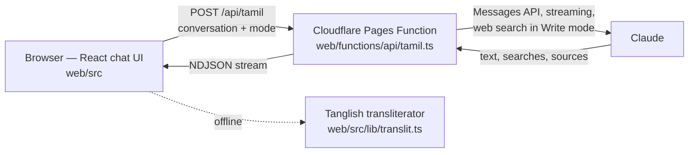

<div align="center">
  <h1>✨ Illakiya (இலக்கியா) ✨</h1>
  <p><b>Research and write anything in Tamil. By Yazhi.</b></p>

  > *Named after இலக்கியம் ("literature"). Ask for an article, letter or post and Illakiya researches and writes it in Tamil; paste English, Tanglish or rough Tamil and get clean Tamil back.*

**Live:** https://illakiya.yazhi.dev · See [NEXT_ACTION.md](./NEXT_ACTION.md) for the roadmap.

</div>

---

## ✍️ How it works

One centred box. Type or paste, pick a mode underneath, press Enter. Answers appear above the box; keep typing below to follow up ("shorter", "make it formal", "add a conclusion").

| Mode | What it does | Runs |
|------|--------------|------|
| **எழுது** (Write) — default | Researches on the web when facts matter, then writes any content in Tamil (articles, letters, posts, speeches, summaries). A bare paste comes back as clean Tamil. Sources are listed under the answer. | Claude + web search |
| **தூய தமிழ்** (Clean) | Anything → clean, natural Tamil | Claude |
| **மொழிபெயர்** (Translate) | English → fluent Tamil, by meaning | Claude |
| **இலக்கணம்** (Grammar) | Minimal fixes: spelling, sandhi (புணர்ச்சி), case endings, agreement | Claude |
| **எழுத்து நடை** (Formal) | Spoken Tamil → formal written Tamil | Claude |
| **Tanglish** | Instant offline transliteration (`vanakkam` → `வணக்கம்`) | Browser |

After a message is sent the mode returns to **எழுது**, so follow-ups read as instructions. In a conversion mode, pasting into an empty box sends straight away.

## 🏗️ Architecture



- **`web/src`** — chat UI: thread on top, centred composer with the mode chips below, copy and text-to-speech per answer, conversation saved in the browser.
- **`web/server/tools.ts`** — the system prompt, per-mode instructions and request validation (40 turns, 20,000 characters a message). Text sent in a conversion mode goes in `<text>` tags as data, never as instructions.
- **`web/functions/api/tamil.ts`** — the only server code. Holds the `ANTHROPIC_API_KEY` secret, enables web search (up to 5 searches) in Write mode, resumes long research turns, and streams text, searches and sources back as NDJSON.

## 🚀 Quick start (web)

```bash
cd web && npm ci
npm test            # unit tests
npm run dev         # UI on http://localhost:5173 (Tanglish tool works offline)
```

To run the Claude tools locally, put your key in `web/.dev.vars` (git-ignored):

```bash
echo "ANTHROPIC_API_KEY=sk-ant-..." > web/.dev.vars
```

```bash
cd web && npm run dev:api   # serves dist + functions on :8788; `npm run dev` proxies /api there
```

Deployment: [docs/DEPLOY.md](./docs/DEPLOY.md).

## 📱 Android keyboard (separate track)

`android/` and `core-rust/` hold the earlier native Tamil keyboard (PM0100 layout, Rust engine, UniFFI). It is not part of the web toolbox and is kept for the keyboard roadmap.

## 📚 Dictionary Sources

| Source | Words | Description |
|--------|-------|-------------|
| **Swadesh + Common** | 247 | Base vocabulary |
| **Sangam Corpus** | 413 | Project Madurai mining (36K unique words scanned) |
| **Modern Tamil** | 30 | Education, government, society |
| **Verbs** | 22 | Common conjugations |
| **Grammar** | 21 | Pronouns, particles, postpositions |
| **Tanglish** | 20 | Borrowed English, colloquial terms |
| **Tech** | 17 | Software, apps, internet |
| **Literary** | 20 | Tinai, turai, Sangam terms |
| **Body & Nature** | 25 | Anatomy, weather, flora |
| **Corpus Frequent** | 21 | High-frequency literary terms |

## 🎨 Sangam Theme Palette

| Color | Name | Hex | Inspiration |
|-------|------|-----|-------------|
| 🔴 **Primary** | `KurunthogaiRed` | `#8B2500` | Kurunthogai love poems |
| 🟤 **Surface** | `MullaiSoil` | `#3E2723` | Forest earth |
| 🟡 **Accent** | `PalaiSand` | `#D4A574` | Desert landscape |
| 🔵 **Dark** | `KurinjiNight` | `#1A1A2E` | Mountain twilight |

## 💻 Tech Stack

- **React + Vite** — web toolbox UI
- **Cloudflare Pages Functions** — `/api/tamil`, Claude via the Anthropic TypeScript SDK
- **Kotlin** — Android UI (Jetpack Compose, Material 3)
- **Rust** — Core engine (state machine, dictionary, sandhi)
- **UniFFI** — FFI bridge (Mozilla, type-safe)
- **JNA** — Java Native Access (runtime FFI loader)

---

## 📜 License & Open Source

Part of the [Yazhi](https://github.com/yazhi-lem) open source ecosystem.  
FLOSS-first. Community-driven. Tamil-powered.

<div align="center">
  <b>வாழ்க தமிழ்! — Long live Tamil!</b>
</div>
