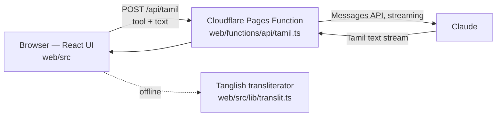

<div align="center">
  <h1>✨ Illakiya (இலக்கியா) ✨</h1>
  <p><b>The Tamil writing toolbox. Paste anything — get clean Tamil.</b></p>

  > *Named after இலக்கியம் ("literature"). English, Tanglish or rough Tamil goes in; clean, grammatical Tamil comes out.*

**Live:** https://illakiya.yazhi.dev · See [NEXT_ACTION.md](./NEXT_ACTION.md) for the roadmap.

</div>

---

## 🧰 The toolbox

| Tool | What it does | Runs |
|------|--------------|------|
| **தூய தமிழ்** (Clean Tamil) — default | Anything (English, Tanglish, mixed, Tamil with mistakes) → clean, natural Tamil | Claude |
| **மொழிபெயர்** (Translate) | English → fluent Tamil, by meaning | Claude |
| **இலக்கணம்** (Grammar) | Minimal fixes: spelling, sandhi (புணர்ச்சி), case endings, agreement | Claude |
| **எழுத்து நடை** (Formal) | Spoken / colloquial Tamil → formal written Tamil | Claude |
| **Tanglish → தமிழ்** | Instant offline transliteration (`vanakkam` → `வணக்கம்`) | Browser |

Paste into the box and the active tool runs straight away (or press **Ctrl/⌘ + Enter**). Copy or listen to the result.

## 🏗️ Architecture



- **`web/src`** — single-screen UI: tool row, input, streamed output, copy, text-to-speech.
- **`web/server/tools.ts`** — one system prompt per tool, request validation (20,000 character limit). Pasted text is sent as data inside `<text>` tags, never as instructions.
- **`web/functions/api/tamil.ts`** — the only server code; holds the `ANTHROPIC_API_KEY` secret and streams the result back as plain text.

## 🚀 Quick start (web)

```bash
cd web && npm ci
npm test            # unit tests
npm run dev         # UI on http://localhost:5173 (Tanglish tool works offline)
```

To run the Claude tools locally, put your key in `web/.dev.vars` (git-ignored):

```bash
echo "ANTHROPIC_API_KEY=sk-ant-..." > web/.dev.vars
```

```bash
cd web && npm run dev:api   # serves dist + functions on :8788; `npm run dev` proxies /api there
```

Deployment: [docs/DEPLOY.md](./docs/DEPLOY.md).

## 📱 Android keyboard (separate track)

`android/` and `core-rust/` hold the earlier native Tamil keyboard (PM0100 layout, Rust engine, UniFFI). It is not part of the web toolbox and is kept for the keyboard roadmap.

## 📚 Dictionary Sources

| Source | Words | Description |
|--------|-------|-------------|
| **Swadesh + Common** | 247 | Base vocabulary |
| **Sangam Corpus** | 413 | Project Madurai mining (36K unique words scanned) |
| **Modern Tamil** | 30 | Education, government, society |
| **Verbs** | 22 | Common conjugations |
| **Grammar** | 21 | Pronouns, particles, postpositions |
| **Tanglish** | 20 | Borrowed English, colloquial terms |
| **Tech** | 17 | Software, apps, internet |
| **Literary** | 20 | Tinai, turai, Sangam terms |
| **Body & Nature** | 25 | Anatomy, weather, flora |
| **Corpus Frequent** | 21 | High-frequency literary terms |

## 🎨 Sangam Theme Palette

| Color | Name | Hex | Inspiration |
|-------|------|-----|-------------|
| 🔴 **Primary** | `KurunthogaiRed` | `#8B2500` | Kurunthogai love poems |
| 🟤 **Surface** | `MullaiSoil` | `#3E2723` | Forest earth |
| 🟡 **Accent** | `PalaiSand` | `#D4A574` | Desert landscape |
| 🔵 **Dark** | `KurinjiNight` | `#1A1A2E` | Mountain twilight |

## 💻 Tech Stack

- **React + Vite** — web toolbox UI
- **Cloudflare Pages Functions** — `/api/tamil`, Claude via the Anthropic TypeScript SDK
- **Kotlin** — Android UI (Jetpack Compose, Material 3)
- **Rust** — Core engine (state machine, dictionary, sandhi)
- **UniFFI** — FFI bridge (Mozilla, type-safe)
- **JNA** — Java Native Access (runtime FFI loader)

---

## 📜 License & Open Source

Part of the [Yazhi](https://github.com/yazhi-lem) open source ecosystem.  
FLOSS-first. Community-driven. Tamil-powered.

<div align="center">
  <b>வாழ்க தமிழ்! — Long live Tamil!</b>
</div>
