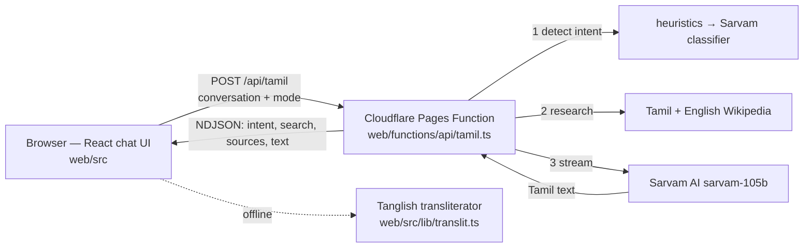

<div align="center">
  <h1>✨ Illakiya (இலக்கியா) ✨</h1>
  <p><b>Research and write anything in Tamil. By Yazhi.</b></p>

  > *Named after இலக்கியம் ("literature"). Ask for anything and Illakiya works out what you need: it researches and writes in Tamil, translates English, cleans up Tanglish or fixes Tamil grammar. Powered by Sarvam AI.*

**Live:** https://illakiya.yazhi.dev · See [NEXT_ACTION.md](./NEXT_ACTION.md) for the roadmap.

</div>

---

## ✍️ How it works

One centred box. Type, ask or paste anything and press Enter. Illakiya works out what you need, answers above the box, and you keep typing below to follow up ("shorter", "make it formal", "add a conclusion").

**Automatic intent detection (தானியங்கு, default).** Every message is classified before it is answered:

| Detected intent | When | What Illakiya does |
|---|---|---|
| **ஆய்ந்து எழுதுதல்** research | questions and essays about real people, places, history, science, current topics | searches Tamil + English Wikipedia, then writes in Tamil from those facts and lists the sources |
| **எழுதுதல்** write | poems, stories, letters, wishes, posts, general answers | writes in Tamil |
| **மொழிபெயர்ப்பு** translate | pasted English | natural Tamil translation |
| **தூய தமிழாக்கம்** clean | Tanglish / mixed text | clean Tamil |
| **இலக்கணத் திருத்தம்** grammar | pasted Tamil | minimal grammar and spelling fixes |
| **எழுத்து நடை** formal | "make this formal" + Tamil | formal written Tamil |
| **திருத்தி எழுதுதல்** revise | follow-up instructions | revises the previous answer |

Fast heuristics (script, Tanglish vocabulary, request words) decide the clear cases instantly. When they are unsure, a small Sarvam call with a JSON schema decides. Each answer shows the detected intent as a badge. The chips under the box force a mode for the next message, and the composer goes back to Auto after each send. **Tanglish** transliterates offline in the browser.

**Tamil quality.** One base prompt sets the standard: correct புணர்ச்சி and வல்லினம் மிகுதல், case endings and agreement, Tamil word order, Tamil words in place of needless loanwords, and no Latin-script English inside Tamil sentences. Each conversion task carries a worked example. Conversions run at low temperature with light reasoning; writing and research get more room and deeper reasoning.

## 🏗️ Architecture



- **`web/server/intent.ts`**: intent heuristics, the classifier prompt and schema, and conversion-payload extraction ("Translate: …").
- **`web/server/prompts.ts`**: the Tamil-standard base prompt, per-intent tasks with examples, and sampling per intent.
- **`web/server/research.ts`**: Wikipedia search and extracts (best effort, 6 s timeout).
- **`web/server/sarvam.ts`**: Sarvam chat client (`api-subscription-key`, SSE parsing, `<think>` filtering).
- **`web/server/request.ts`**: request validation (40 turns, 20,000 characters a message).
- **`web/functions/api/tamil.ts`**: the only server entry point. It holds `SARVAM_API_KEY`.

## 🚀 Quick start (web)

```bash
cd web && npm ci
npm test            # unit tests
npm run dev         # UI on http://localhost:5173 (Tanglish tool works offline)
```

To run the Sarvam-powered modes locally, put your key in `web/.dev.vars` (git-ignored):

```bash
echo "SARVAM_API_KEY=your-sarvam-key" > web/.dev.vars
```

```bash
cd web && npm run dev:api   # serves dist + functions on :8788; `npm run dev` proxies /api there
```

Deployment: [docs/DEPLOY.md](./docs/DEPLOY.md).

## 📱 Android keyboard

`android/` + `core-rust/`: a native PM0100 Tamil keyboard (Kotlin/Compose IME on a Rust engine through UniFFI). It works offline and has no network permission. CI builds the APKs and AAB. Status, local build steps and the Play Store checklist are in [docs/RELEASE_ANDROID.md](docs/RELEASE_ANDROID.md).

## 📚 Dictionary Sources

| Source | Words | Description |
|--------|-------|-------------|
| **Swadesh + Common** | 247 | Base vocabulary |
| **Sangam Corpus** | 413 | Project Madurai mining (36K unique words scanned) |
| **Modern Tamil** | 30 | Education, government, society |
| **Verbs** | 22 | Common conjugations |
| **Grammar** | 21 | Pronouns, particles, postpositions |
| **Tanglish** | 20 | Borrowed English, colloquial terms |
| **Tech** | 17 | Software, apps, internet |
| **Literary** | 20 | Tinai, turai, Sangam terms |
| **Body & Nature** | 25 | Anatomy, weather, flora |
| **Corpus Frequent** | 21 | High-frequency literary terms |

## 🎨 Sangam Theme Palette

| Color | Name | Hex | Inspiration |
|-------|------|-----|-------------|
| 🔴 **Primary** | `KurunthogaiRed` | `#8B2500` | Kurunthogai love poems |
| 🟤 **Surface** | `MullaiSoil` | `#3E2723` | Forest earth |
| 🟡 **Accent** | `PalaiSand` | `#D4A574` | Desert landscape |
| 🔵 **Dark** | `KurinjiNight` | `#1A1A2E` | Mountain twilight |

## 💻 Tech Stack

- **React + Vite** — web toolbox UI
- **Cloudflare Pages Functions** — `/api/tamil`, Sarvam AI (`sarvam-105b`) + Wikipedia research
- **Kotlin** — Android UI (Jetpack Compose, Material 3)
- **Rust** — Core engine (state machine, dictionary, sandhi)
- **UniFFI** — FFI bridge (Mozilla, type-safe)
- **JNA** — Java Native Access (runtime FFI loader)

---

## 📜 License & Open Source

Part of the [Yazhi](https://github.com/yazhi-lem) open source ecosystem.  
FLOSS-first. Community-driven. Tamil-powered.

<div align="center">
  <b>வாழ்க தமிழ்! — Long live Tamil!</b>
</div>
